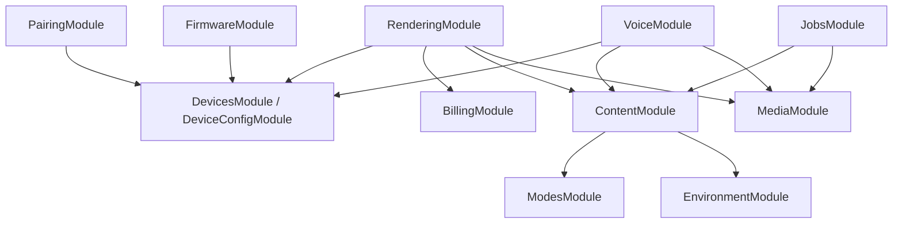

# InkSight 后端迁移方案：`backend` → `services` / NestJS + TypeScript

- 日期：2026-11-13
- 状态：迁移设计稿（按 NestJS 架构重构）
- 基线分支：`migration/backend-nestjs-ts`
- 基线提交：`4d8c673`
- 目标目录：`services/`
- 适用范围：InkSight 后端全部业务逻辑、运行时脚本、测试、调试和部署入口

## 1. 目标与边界

本次迁移在 `services/` 中按照 NestJS 的模块、依赖注入和请求生命周期重新实现现有后端，技术栈改为 NestJS + TypeScript。代码按业务能力组织，重新划分 Controller、Service、业务规则、Repository 和外部 Provider 的职责。原 Python 文件、函数、全局单例和调用结构仅用于提取业务规则与验证行为，不作为新代码的组织模板。

保留的是原有业务逻辑、数据和对外行为，包括权限、配置优先级、状态流转、计费额度、缓存策略、内容生成与降级、渲染和语音协议。允许改变内部接口、类名、数据模型表达和实现算法；任何会影响业务结果的规则调整必须单独列出原因和验收用例，不能借架构迁移隐式改变产品行为。

“全部业务逻辑”包含 HTTP 路由背后的认证、配置、设备状态、渲染、模式、LLM、天气、缓存、统计、语音、OTA、上传、调度和词汇复习逻辑，也包含数据库迁移、运行时资源加载和后端联调脚本。字体、内置模式 JSON 和艺术图放入 `services/resources/`；用户上传、自定义模式文件等可写数据放入配置的持久化目录。WebApp 和固件仍是独立工程。

架构重构与业务迁移在同一阶段完成，每个业务用例都直接进入目标 NestJS 模块，再通过业务测试和协议测试证明行为等价。`/api` 与 `/api/v1` 两个前缀、设备认证头、用户 Cookie、管理端鉴权、JSON 字段、HTTP 状态码、BMP/PNG 输出、SSE 事件和 WebSocket 消息作为迁移契约。迁移期间保留原 `backend/` 作为行为参照与回滚版本；新服务的运行时不依赖旧 Python 服务。

## 2. 现状基线

当前 FastAPI 入口为 `backend/api/index.py`，启动生命周期初始化主数据库、统计表、缓存数据库、静态表和设备状态兼容列。路由在 `backend/api/routes/__init__.py` 注册，并分别挂载到 `/api` 和 `/api/v1`。

### 2.1 API 业务域

| 现有模块（业务来源） | 主要职责 | NestJS 业务归属（允许跨文件重组） |
| --- | --- | --- |
| `render.py` | 设备渲染、浏览器预览、流式预览、缓存清理 | `RenderingModule` |
| `device.py` | 心跳、状态、刷新、模式切换、收藏、历史、习惯、告警、绑定和分享 | `DevicesModule`、`PairingModule`、`EngagementModule`、`VocabularyModule`、`RenderingModule` |
| `config.py` | 配置保存、读取、历史、激活、专注监听 | `DeviceConfigModule` |
| `admin_devices.py` | root 管理员设备列表和配置编辑 | `DevicesModule`、`DeviceConfigModule` 的管理 Controller |
| `admin_pairing.py` | 配对码查询、创建、失效 | `PairingModule` 的管理 Controller |
| `admin_analytics.py` | 页面访问记录、后台概览和历史统计 | `AnalyticsModule` 的公共/管理 Controller |
| `auth.py` | 注册、登录、登出、重置密码、邀请兑换、当前用户 | `IdentityModule`、`UsersModule`、`BillingModule` |
| `user.py` | 用户资料、设备成员、设备请求、邮箱、用户模型配置 | `UsersModule`、`DevicesModule`、`BillingModule` |
| `mobile.py` | 今日内容、偏好、推送令牌、小组件数据 | `ContentModule`、`UsersModule`、`NotificationsModule`、`RenderingModule` |
| `modes.py` | 模式目录、预览、创建、删除、AI 生成 | `ModesModule`、`RenderingModule` |
| `discover.py` | 共享模式发布和安装 | `ModesModule` |
| `voice.py` | 用户/设备语音会话、SSE、音频和图片、设备 WebSocket | `VoiceModule` |
| `firmware.py` | 固件健康检查、GitHub Releases、校验和下载代理 | `FirmwareModule`、`HealthModule` |
| `device_ota.py` | OTA 触发、状态、取消、进度 | `FirmwareModule` |
| `stats.py` | 统计概览、设备统计、渲染历史 | `AnalyticsModule` |
| `uploads.py` | 图片上传、元数据、下载和清理 | `MediaModule` |
| `locations.py` | 地点搜索 | `EnvironmentModule` |
| `pages.py` | 兼容页面、控制台、静态资源和缩略图 | `PagesModule`、`MediaModule` |

以上是业务覆盖清单，不是文件翻译清单。Web、设备、移动端和管理端的入口可以有不同 Controller，但同一业务能力必须复用模块公开的 Service。禁止创建与旧 `api/shared.py`、`config_store.py` 等价的全局业务集合。

### 2.2 核心业务域

| 现有文件 | 迁移职责 |
| --- | --- |
| `config_store.py`、`static_store.py`、`db.py` | 数据访问、配置历史、设备状态、用户和设备关系 |
| `pipeline.py`、`content.py`、`json_content.py`、`context.py` | 内容生成、天气/日期上下文、LLM、外部数据和模式调度 |
| `mode_registry.py`、`mode_catalog.py`、`mode_generator.py`、`layout_presets.py` | 模式加载、校验、目录、布局 DSL 和 AI 生成 |
| `renderer.py`、`json_renderer.py`、`image_processing.py` | 文本/图片布局、字体、图像处理、BMP/PNG 输出 |
| `native_dither.py`、`native/eink_dither.cpp` | Atkinson 黑白/调色板抖动 |
| `cache.py` | 内存缓存、SQLite 持久化缓存、预生成、TTL 和缓存失效 |
| `voice_service.py` | 语音会话、ASR/TTS、LLM 流式响应、Opus、临时图片和音频 |
| `auth.py`、`crypto.py`、`i18n.py`、`errors.py` | JWT、设备令牌、root 权限、API Key 加密、多语言错误 |
| `stats_store.py`、`activity_store.py` | 心跳、渲染、内容历史、页面活动和统计聚合 |
| `static_content.py`、`static_store.py` | 静态诗词、谜语、历史今日的数据获取、消费记录和降级规则 |
| `scheduler.py` | 每日/每周内容任务和运行时调度 |
| `vocab_store.py` | 词库、复习进度和设备复习会话 |

### 2.3 存储与资源

- `inksight.db`：主业务 SQLite 数据库。
- `cache.db`：图像和黄历缓存 SQLite 数据库。
- `backend/migrations/__init__.py`：主库递增迁移和 `schema_versions` 记录。
- `runtime_uploads/`：用户上传图片与元数据，需要持久化卷。
- `fonts/`、`static/`、`core/modes/`、`core/vocab_data/`：服务运行时资源。
- `.env.example`：LLM、语音、天气、翻译、SMTP、鉴权、数据库、上传、字体和调试配置。

当前数据库使用 WAL 和 busy timeout，并存在多次增列、兼容旧表、活动记录、推送、共享模式和词汇复习迁移。迁移不能通过重新建空库替代数据迁移。

## 3. NestJS 目标架构与目录结构

采用按业务能力划分的模块化单体，部署为一个常驻 NestJS 应用；渲染 worker 和调度进程按运行需求拆出。模块内部按实际复杂度拆分 Service、规则对象和 Repository，不强制每个模块引入多层空转包装。

```text
services/
├── package.json
├── package-lock.json
├── tsconfig.json
├── nest-cli.json
├── eslint.config.mjs
├── jest.config.ts
├── .env.example
├── src/
│   ├── main.ts                 # 启动、适配器配置、双前缀、优雅退出
│   ├── app.module.ts           # 组合业务模块与基础设施
│   ├── config/                 # 环境变量 schema、默认值和配置访问
│   ├── common/                 # 通用装饰器、Pipe、Interceptor、异常 Filter
│   ├── infrastructure/
│   │   ├── database/           # 连接、事务、迁移执行器；无跨域业务 Repository
│   │   ├── cache/              # 缓存存储能力；业务缓存策略归各业务模块
│   │   ├── logging/            # 日志和追踪
│   │   └── storage/            # 文件存储 Adapter
│   └── modules/
│       ├── identity/           # IdentityModule：会话、凭据、认证和角色 Guard
│       ├── users/              # UsersModule：资料、邮箱、偏好和模型配置
│       ├── devices/            # DevicesModule：设备状态、成员、访问策略和告警
│       ├── device-config/      # DeviceConfigModule：配置版本、激活、有效配置
│       ├── pairing/            # PairingModule：配对码、claim 和绑定流程
│       ├── billing/            # BillingModule：额度、邀请兑换、计费决策
│       ├── modes/              # ModesModule：定义、目录、发布安装、布局 DSL
│       ├── environment/        # EnvironmentModule：地点、天气、日期与农历
│       ├── content/            # ContentModule：生成策略、LLM、静态内容、降级
│       ├── rendering/          # RenderingModule：设备渲染、预览和小组件用例
│       ├── media/              # MediaModule：上传、字体、图片、抖动和位图编码
│       ├── engagement/         # EngagementModule：收藏、内容历史和习惯
│       ├── vocabulary/         # VocabularyModule：词库、复习算法和会话
│       ├── voice/              # VoiceModule：语音状态机、Gateway、ASR/TTS
│       ├── firmware/           # FirmwareModule：Releases、下载、OTA 状态机
│       ├── analytics/          # AnalyticsModule：事件、统计、后台查询
│       ├── notifications/      # NotificationsModule：邮件、推送令牌与发送
│       ├── jobs/               # JobsModule：定时入口、租约、任务生命周期
│       ├── pages/              # PagesModule：兼容页面和控制台入口
│       └── health/             # HealthModule：存活与就绪检查
├── resources/
│   ├── modes/builtin/          # 原 core/modes/builtin
│   ├── vocab_data/
│   ├── fonts/
│   └── static/
├── var/                        # 可写数据目录，开发忽略、生产挂载持久化卷
│   ├── databases/
│   ├── uploads/
│   └── modes/custom/           # 文件形式的自定义模式；数据库定义由 ModesModule 管理
├── migrations/                 # 可审计的 TypeScript/SQL 迁移
├── scripts/                    # 迁移、字体、词库、抖动、联调脚本
└── test/
    ├── unit/
    ├── integration/
    ├── contract/
    ├── golden-render/
    └── e2e/
```

`resources/` 存放构建时可校验的资源，用户上传、自定义资源和数据库写入 `var/` 或配置的持久化路径。目标代码不能导入 `backend`、调用 Python 子进程或代理到旧服务来完成业务；经验证的原生图像/音频库可封装为 Node Provider。资源复用须校验内容哈希。

### 3.1 模块内部组织

以设备配置为例，普通用户和管理端复用同一配置用例，区别由入口权限策略表达：

```text
modules/device-config/
├── device-config.module.ts       # imports、controllers、providers、exports
├── device-config.controller.ts   # 原配置接口，调用配置用例
├── admin-device-config.controller.ts
├── device-config.service.ts      # 保存、激活、历史和有效配置用例
├── dto/                         # 请求校验和协议字段映射
├── policies/                    # 模式覆盖、配置合并、激活规则
├── repositories/                # 配置与版本的数据访问 Provider
└── device-config.service.spec.ts
```

- **Module** 声明依赖和导出能力；跨模块只访问明确导出的 Service/Provider，不引用内部文件和 Repository。
- **Controller / Gateway** 适配 HTTP、SSE 和原生 WebSocket 协议，接收 DTO 和身份上下文；不包含 SQL、扣额、模式选择或第三方 SDK 调用。
- **Service** 表达业务用例和状态变更，决定操作顺序与事务范围；复杂规则提取为策略或纯 TypeScript 对象，避免形成巨型 Service。
- **Repository** 属于对应业务模块，封装 SQL、实体映射和原子更新；`DatabaseModule` 只提供连接、事务和迁移基础能力。
- **Provider / Adapter** 封装 LLM、天气、邮件、ASR/TTS、文件和渲染引擎。通过 DI token 注入可替换依赖，测试使用真实存在的替代实现；无变化需求的内部函数保持简单。

### 3.2 NestJS 请求生命周期与依赖约束

HTTP 通过 Middleware → Guard → Interceptor / Pipe → Controller → Service → Repository / Provider 完成处理；异常由 Filter 映射。DTO 使用 `ValidationPipe` 完成转换与校验，并按原契约处理未知字段、可选值和默认值。错误响应和二进制/SSE 输出分别适配，避免全局 JSON 包装破坏协议。

认证 Guard 解析用户、设备或管理凭据，业务模块的 Policy/Guard 判断 owner、member、root 等操作权限。不同管理凭据的授权范围沿用现有接口，不能把 `ADMIN_TOKEN` 当作 root 会话通行证。HTTP 与 WebSocket 共用业务 Service；设备语音使用原生 WebSocket Adapter/Gateway 保持消息格式，不引入 Socket.IO 协议。

依赖通过构造函数注入、`imports`/`exports` 和 Provider token 声明。业务模块不创建数据库全局连接，不从 HTTP Request 读取环境配置，也不使用服务定位器访问其他模块。出现循环依赖时调整用例归属或提取共享能力；不以大面积 `forwardRef()` 作为模块设计。

核心依赖方向为：



该图只展示关键业务调用。基础设施由 DI 提供；内容与媒体模块不反向依赖渲染入口，模式管理不通过调用渲染模块完成预览。原 `/modes/.../preview` 路径由 `RenderingModule` 的 Controller 承接，避免双向模块依赖。

### 3.3 原业务规则的重新归属

以下规则通过 CodeGraph 的调用关系及返回源码核对；实施时还需补齐完整用例测试，不能把图谱中“未找到覆盖测试”视为确认没有测试。

| 规则来源 | 新架构职责 | 必须保留的行为 |
| --- | --- | --- |
| `api/shared.py:resolve_mode`、`choose_persona_from_config` | `RenderingModule` 模式选择策略，调用设备状态与模式查询能力 | 待切模式、显式模式、next、random/cycle/time_slot/smart 的选择优先级及回退；cycle 索引的推进规则 |
| `api/shared.py:build_image` | 渲染用例调用 `UsersModule`、`BillingModule` 和缓存 Provider | 请求/当前用户/设备 owner 的 Key 选择、BYOK 条件、扣额归属、缓存命中时的额度校验、预览覆盖隔离 |
| `core/pipeline.py:get_effective_mode_config`、`generate_and_render` | 配置合并策略、内容生成用例和媒体渲染 Provider | 模式覆盖、多语言、静态内容优先、LLM 降级和自定义模式的设备隔离 |
| `core/config_store.py:consume_user_free_quota` | `BillingModule` Service + Repository | 条件更新原子扣额、余额不足不修改、调用次数统计规则 |
| `api/shared.py:ensure_web_or_device_access`、`require_membership_access` | 身份认证与 `DevicesModule` 访问策略 | 设备 Token 与用户成员访问路径、owner-only 和原错误码 |
| `api/routes/voice.py:device_voice_ws` | `VoiceModule` Gateway + 会话 Service + ASR/TTS Provider | 原生 WS、握手后认证及失败关闭码、音频分片、commit/interrupt、断开清理 |
| `core/scheduler.py:start_scheduler` 与 `api/shared.py:lifespan` | `JobsModule` 与 Nest 生命周期 Hook | 保留任务规则；显式核对启用状态。现入口生命周期未调用 `start_scheduler`，不能因注册新模块自动启用后台任务 |

事务覆盖配对消费、成员绑定、配置版本激活和额度扣减等需要一致性的操作。跨模块事务由应用用例协调并使用同一事务作用域；外部 LLM、语音和下载不持有数据库事务。扣额、配对失效和重复请求的竞争条件使用真实 SQLite 并发集成测试验证。

## 4. 技术栈建议

### 4.1 应用运行时

- Node.js 20 LTS（或在实施开始时统一决定 Node 22 LTS），CI、开发和生产保持同一主版本。
- NestJS、TypeScript strict、`@nestjs/config`、`@nestjs/platform-express`。
- 业务模块通过 `@Module` 组合、`@Injectable` Provider 和构造函数注入依赖；环境配置使用类型化 `ConfigService`，资源初始化与释放使用 Nest 生命周期 Hook。
- 初期使用 Express 适配器，降低现有中间件、SSE、二进制响应和代理行为差异；性能稳定后再评估 Fastify。
- `pino`/Nest Logger 输出结构化日志，保留 request id、设备 MAC、路由、状态码和耗时，禁止打印令牌、Cookie 和 API Key。

### 4.2 数据库

建议先评估 Drizzle ORM + `better-sqlite3`，驱动通过 Nest Provider 注入，类型化 Repository 放在所属业务模块中。数据库行结构通过映射转换为业务类型，避免旧表结构决定 Service 的接口。迁移前用渲染、语音、批量预生成和并发心跳压测验证同步 SQLite 驱动是否阻塞事件循环；如不满足，再切换异步 SQLite 驱动。

所有迁移脚本必须：

1. 支持现有 `inksight.db` 和 `cache.db` 的备份后原地升级。
2. 首轮保留表名、主键、索引、唯一约束、默认值和时间字段语义，以支持数据兼容与回滚；内部业务对象按新架构建模，后续表结构调整另用显式迁移执行。
3. 记录迁移版本、名称和时间，并提供失败恢复信息。
4. 提供只读校验命令，对比表数量、记录数量、关键聚合、配置哈希和最新心跳。

### 4.3 鉴权与加密

- JWT 继续使用 HS256，并保持 `ink_session` Cookie、`sub`、`username`、过期时间和 `SameSite=Lax` 语义。
- `X-Device-Token`、用户 Cookie/Bearer 与 `ADMIN_TOKEN` 分别保留原认证范围；root 权限通过用户角色确认，不能与静态管理 Token 混用。
- MAC 地址格式规范化由 Pipe 处理；身份认证使用 Guards，设备成员和 owner/root 操作权限由所属模块的 Policy Service 判断。
- 现有 Fernet 加密 API Key 不能简单改成 AES-GCM；Node 端需实现与现有 Fernet 兼容的解密/加密适配器，先用固定测试向量验证，再切换写入。
- `ENCRYPTION_KEY`、`JWT_SECRET`、`ADMIN_TOKEN` 只从运行环境或受保护文件读取，不进入仓库和日志。

### 4.4 LLM、外部服务与调度

- 文本模型使用 npm `openai` 的 OpenAI-compatible client，按 provider 配置保留 DeepSeek、DashScope、Moonshot 和用户自定义配置。
- 天气、GitHub Releases、地点、翻译、邮件等外部调用统一封装为带超时、重试、取消和错误分类的 Provider。
- `JobsModule` 使用 `@nestjs/schedule` 注册任务入口，调用内容、媒体和通知模块公开的用例。任务开关、时区、执行时间和错过调度的处理须显式配置；生产多实例采用单调度进程或租约，防止重复执行。
- DashScope ASR/TTS WebSocket 使用独立 adapter，明确 upstream 连接超时、最大事件大小、心跳、取消和关闭时清理规则。

### 4.5 图像、字体与抖动

- 首选 `sharp` 负责图片读取、缩放、格式转换；文字布局可通过 SVG overlay 或经验证的 Canvas/Skia 实现。
- TTF 继续作为矢量字体来源；PCF 点阵字体需要保留兼容读取路径或在迁移阶段转换为服务可读格式。
- 黑白、三色、四色调色板和 BMP 字节协议必须以现有输出为黄金样本。
- 原生 Atkinson 抖动先通过 N-API/WASM/独立 worker adapter 接入；纯 TypeScript 实现只在性能和像素差异达到门槛后替代。
- 大图渲染放入 worker thread 或队列，避免阻塞 NestJS 事件循环。

## 5. API 兼容契约

迁移阶段固定以下行为：

| 契约 | 兼容要求 |
| --- | --- |
| 基础路径 | 同时提供 `/api` 和 `/api/v1` |
| 设备认证 | 继续读取 `X-Device-Token`，区分缺失和无效 Token |
| 用户认证 | 继续读写 `ink_session` Cookie，并接受用户 Bearer Token |
| 管理认证 | 保留各接口原有的 root 用户会话/Bearer 或 `ADMIN_TOKEN` 权限范围 |
| 内容响应 | 保持 `image/bmp`、`image/png`、`application/json`、SSE 的 Content-Type 和状态码 |
| 设备响应头 | 保留 `X-Pending-Refresh`、`X-Content-Fallback`、`X-Preview-Push` 等现有语义 |
| 流式响应 | 保持事件名、JSON 字段、结束事件和错误事件顺序 |
| WebSocket | 保持 `/api/device/{mac}/voice/ws` 路径、消息格式、关闭码和音频分片语义 |
| 错误 | Filter 按接口保留现有错误状态码和响应体，包括 `{error, message}`、`{detail}`、参数校验和语音特定错误结构 |
| 资源地址 | 上传、缩略图、静态资源和 WebApp 代理地址保持可访问 |

迁移前应从现有 FastAPI 测试、`docs/api.md`、WebApp API Route 和固件请求代码生成一份契约清单。NestJS 的 Swagger 输出只能作为辅助，最终以请求/响应快照和设备实测为准。对外路径可以保持 `/modes`、`/device` 等旧命名，内部由对应新业务模块承接；协议兼容不要求保留旧实现结构。

兼容测试覆盖 NestJS 的默认差异，包括 POST 默认 201、DTO 数值/布尔转换、参数缺省、异常格式、Cookie 属性、文件响应头、SSE 结束/错误事件以及 WebSocket 握手。逐接口设置 `@HttpCode`、Pipe 和 Filter，避免框架默认值造成行为变化。

## 6. 数据迁移方案

### 6.1 迁移前保护

1. 停止写入或进入短暂维护窗口。
2. 复制并校验 `inksight.db`、`cache.db`、`runtime_uploads/`、字体和模式资源。
3. 记录 SQLite schema、`schema_versions`、记录数、最新设备心跳、配置版本和用户数。
4. 备份当前 `.env`、JWT secret 文件和部署环境变量名称；凭据本身不写入迁移文档或 Git。

### 6.2 主库迁移

先通过新业务模块的 Repository 读取原数据库，映射为目标业务类型，完成只读查询和统计对账。数据库兼容适配留在 Repository 内部，不进入 Controller 和业务规则。首个 TypeScript migration 先检查真实表结构与既有 `schema_versions` 的对应关系；确认结构一致后建立基线，不能仅凭版本号跳过校验或复制旧启动时的零散建表逻辑。

关键对象包括：

- `configs`、`device_state`、配置历史和模式覆盖。
- `users`、`user_devices`、`device_memberships`、`device_access_requests`。
- `device_claim_tokens`、`invitation_codes`、`api_quotas`、`user_llm_config`。
- `user_preferences`、`push_tokens`、`shared_modes`、`custom_modes`。
- `render_logs`、`device_heartbeats`、`content_history`、`habit_records`。
- `user_activity_events`、`vocab_items`、`vocab_progress`、`vocab_session_state`。

缓存库可以在切换时清空并按策略预热，但主库、上传文件和模式定义不得丢失。清空缓存必须有显式命令和日志。

### 6.3 对照验证、切换与回滚

旧后端作为独立行为参照。使用同一脱敏数据库快照的两份副本、固定时钟/随机源和外部服务桩，分别运行原用例与新 NestJS 用例，对比响应与数据库副作用。所谓“只读”请求也需核对是否推进模式索引、消费待刷新状态、调用付费模型或写日志，不能仅按 HTTP 方法判定。

默认采用维护窗口内切换单一写入方：停止旧服务写入、备份数据、新服务迁移与核验、切换流量，再开放写入。验证环境可并行运行两套服务，但不对同一生产 SQLite 文件执行镜像业务写入，避免重复扣额、重复绑定和状态漂移。若后续确需在线影子流量或双写，应单独设计幂等、隔离、重放与补偿方案。

切换后保留旧服务和数据库备份，设定明确回滚窗口。回滚前判断新写入是否仍兼容旧结构；恢复备份会丢弃切换后的新数据，必须先保留这段数据并定义补偿办法。新架构不因对照验证而依赖旧服务执行生产业务。

## 7. 调试、脚本与开发体验

### 7.1 `services/package.json` 脚本

建议至少提供：

```text
npm run dev                 # Nest watch mode
npm run build               # 编译 dist
npm run start               # 生产进程
npm run start:debug         # inspector + debug 日志
npm run lint                # ESLint
npm run format:check        # Prettier 检查
npm run typecheck           # tsc --noEmit
npm test                    # 单元测试
npm run test:integration    # SQLite/HTTP/外部服务 stub
npm run test:contract       # API 契约回归
npm run test:golden         # 图像黄金样本
npm run db:migrate         # 执行迁移
npm run db:status           # 查看迁移状态
npm run db:backup           # 备份主库、缓存库和上传资源
npm run assets:fonts        # 下载/校验字体
npm run assets:vocab        # 下载/生成词库数据
npm run native:dither       # 构建或检查原生抖动适配器
npm run debug:focus-alert   # 专注告警联调
npm run debug:device        # 设备心跳/渲染/状态检查
```

脚本应支持 `--base-url`、`--mac`、`--token`、`--json` 等参数，默认不打印敏感值。设备联调脚本需要明确区分模拟请求和真实设备请求。

### 7.2 日志和本地调试

- 默认监听 `0.0.0.0:8080`，保持 WebApp 的 `INKSIGHT_BACKEND_API_BASE` 默认值不变。
- 开发环境允许局域网 CORS 和详细日志，生产环境使用明确 Host/Origin 白名单。
- 为每个请求附加 request id；设备 MAC、用户 id 和 route 可记录，Token、Cookie、API Key 和音频内容不得记录。
- 为 render、preview、voice、OTA、upload 提供可控 debug flag 和耗时指标。
- 为上游 LLM、天气、GitHub、DashScope 提供 mock adapter，单元测试不能依赖真实 Key 或网络。

### 7.3 旧 Python 脚本处理

按目标服务的运行需求重建 TypeScript/Node CLI，保留原工具的能力与参数语义。以下是能力对应关系，命令和实现可按 NestJS 工程重新设计：

- `backend/scripts/setup_fonts.py` → `services/scripts/setup-fonts.ts`
- `backend/scripts/import_kylebing_vocab.py` → `services/scripts/import-vocab.ts`
- `backend/scripts/build_native_dither.py` → `services/scripts/build-native-dither.ts`（调用 node-gyp/CMake 或检查构建产物）
- `backend/scripts/test_focus_alert.py` → `services/scripts/test-focus-alert.ts`

词库和字体的外部下载应增加 URL、校验和、超时、断点/临时文件和重复执行保护。迁移期间可保留 Python 工具作为一次性资源生成器，但运行时和 CI 不能再依赖 Python 后端。

涉及领域状态的脚本通过 Nest application context 解析业务 Provider，复用同一用例并在结束时关闭连接；不在 CLI 中重新实现扣额、设备绑定、配置激活等业务。纯字体下载和原生构建工具可直接使用 Node，无需启动 HTTP 服务。

## 8. CI、部署和发布改造

### 8.1 CI

将 `.github/workflows/ci.yml` 的后端任务替换为 Node 任务，同时保留 WebApp 和固件任务：

1. `actions/setup-node` 固定 Node 主版本。
2. 在 `services/` 执行 `npm ci`，缓存 `services/package-lock.json`。
3. 运行 lint、format check、typecheck、unit、integration、contract 和 golden-render。
4. 使用临时 SQLite 文件、模拟外部 Provider 和测试环境变量。
5. 迁移期间 Python pytest 仅用于原行为基线；新测试通过 `@nestjs/testing`、Provider 替换和 HTTP/WS 集成验证业务，不按 Python 私有函数逐个翻译测试。完成切换后移除后端 Python job。
6. 在 PR 中上传 API 契约差异、图像黄金样本差异和数据库对账报告。

### 8.2 本地部署

更新 `docs/deploy.md`、`docs/en/deploy.md`、`docs/faq.md`、`CONTRIBUTING.md`、README 和语音文档：

```bash
cd services
npm ci
npm run db:migrate
npm run dev
```

本地入口仍为 `http://127.0.0.1:8080`。WebApp 的 `INKSIGHT_BACKEND_API_BASE`、移动端的 `EXPO_PUBLIC_INKSIGHT_API_BASE` 和固件服务地址继续指向同一 API 基地址。

### 8.3 生产部署

现有 `backend/vercel.json` 是 `@vercel/python` 入口，迁移后不能继续作为 NestJS 生产入口。推荐使用常驻 Node 进程或容器：

- 构建阶段执行 `npm ci`、`npm run build`、资源校验和数据库迁移检查。
- 运行阶段执行 `node dist/main.js`，通过反向代理提供 HTTPS、压缩、超时和 WebSocket 转发。
- 主库和 `runtime_uploads` 使用持久化卷；容器实例不能把本地临时盘当作唯一存储。
- 语音 WebSocket、SSE 和 OTA 下载需要设置足够的连接/读取超时，并验证代理不会缓冲流式响应。
- 调度任务只在一个 worker 或获得租约的实例中运行。
- 发布采用蓝绿或 canary；健康检查至少覆盖 `/api/health`、数据库读取、模式加载和上传目录可写性。

仓库中需新增 `services/Dockerfile`、本地容器编排、生产环境变量样例，以及启动、部署、备份、回滚和冒烟检查脚本；按实际生产平台选择进程管理配置。已有 `backend/vercel.json`、CI 后端任务和文档中的 Python 启动命令在切换后移除或替换。灰度按实例或设备分组指定唯一写入方，不能把同一设备的有状态请求随机分发给新旧两个业务运行时。

如果必须继续使用 Vercel，应把短请求 API 与长期 WebSocket/流式语音拆分，Node Serverless 只承载无状态短请求，realtime 服务单独部署，并更新 WebApp 和固件的路由配置。

### 8.4 回滚

发布包保留旧 Python 发布版本或上一 NestJS 版本，以及其运行依赖、迁移版本、数据库备份和资源清单。回滚顺序为：停止新版本写入 → 保存切换后数据 → 核对数据库兼容性并选择代码回退或数据恢复 → 启动旧版本 → 切回 API/代理流量 → 验证设备心跳和关键用例 → 处理待补偿数据。回滚脚本必须说明写入影响与恢复点。

## 9. 分阶段实施计划

- [ ] **阶段 0：业务规则与模块设计**。通过 CodeGraph 和完整用例核对业务规则，冻结 JSON/SSE/WebSocket/图像契约，确定模块公开能力、数据归属、依赖方向、事务和副作用；建立业务用例与验收用例的追踪清单。
- [ ] **阶段 1：NestJS 骨架**。创建 `services/`、业务 Module、DI、类型配置、Pipe、Guard、Interceptor、Filter、日志、CORS、Host、限流、健康检查、双前缀和生命周期 Hook。
- [ ] **阶段 2：数据与身份基础**。建立 Database Provider、分业务 Repository、数据映射与迁移基线；实现 Identity/Users/Billing 的基础能力，验证 JWT、Cookie、设备凭据、用户角色和原子扣额。
- [ ] **阶段 3：设备与用户用例**。在 Devices、DeviceConfig、Pairing、Engagement、Vocabulary、Analytics 中重建配置激活、绑定/审批、状态、心跳、告警、收藏、历史、习惯和词汇复习；验收业务结果、权限与并发事务。
- [ ] **阶段 4：内容与渲染用例**。按 Modes → Environment/Content → Rendering/Media 的依赖组织模式、上下文、生成策略、布局、字体、BMP/PNG 和缓存；保留模型配置、BYOK、额度和降级行为，完成黄金图与性能验证。
- [ ] **阶段 5：扩展入口**。在相应业务模块实现 OTA、Releases、上传、共享模式、移动端、小组件和管理页面；不同客户端 Controller 复用同一业务 Service。
- [ ] **阶段 6：语音与任务**。以 Gateway、会话 Service 和 ASR/TTS Provider 实现原生 WS/HTTP/SSE、Opus、取消和清理；JobsModule 显式配置启用状态、时区与租约。
- [ ] **阶段 7：脚本、CI 与部署**。按新应用生命周期重建资源工具、业务 CLI、Node CI、容器/进程入口、监控、备份和回滚，更新开发文档。
- [ ] **阶段 8：对照和切换**。在隔离数据副本上对照响应和副作用，完成真实设备验证、单一写入方切换、灰度观察和回滚演练。
- [ ] **阶段 9：清理**。确认旧服务无流量、数据和资源已迁移，删除 Python 运行入口和过期文档引用，保留迁移记录和最终备份。

每个阶段完成后更新本文件的复选框、规则追踪清单、测试报告、数据对账结果和未解决风险。每个用例交付同时满足目标架构、原业务逻辑和协议兼容，不设“先逐文件翻译、最后统一重构”的阶段。当前复选框均为后续实施任务，本次仅更新设计文档。

## 10. 验收标准

### 架构与业务逻辑

- 代码按 `modules/<业务能力>` 组织，Module 的 imports/providers/exports 与实际职责一致；旧文件到新文件不要求一一对应。
- Controller/Gateway 只承接协议与用例调用，DTO/Pipe、Guard/Policy、Service、Repository 和外部 Provider 各有明确职责。
- 原 `api/shared.py`、`config_store.py`、`voice_service.py` 的混合职责已按业务重组，没有迁移为等规模的共享集合或巨型 Service。
- 跨模块仅依赖公开能力，不直接访问其他模块 Repository；依赖图无循环，连接、worker、语音会话和定时器可由 Nest 生命周期释放。
- 服务运行不依赖旧 Python 进程；生产和测试通过相同业务接口使用不同 Provider。
- 模式选择/覆盖、Key 优先级、BYOK、额度、静态内容降级、设备隔离、绑定、配置、习惯和复习等规则均有“旧规则 → 新业务用例 → 测试”的追踪记录。

### API 与客户端

- 所有现有 API 路由在 `/api`、`/api/v1` 下通过契约测试。
- WebApp、移动端和固件无需修改即可完成登录、配置、预览、渲染、心跳、状态、OTA、上传和分享流程。
- 设备在真实硬件上收到与旧服务等价的 BMP；响应头和刷新/缓存语义正确。
- SSE 和语音 WebSocket 能完成正常、超时、取消、断线重连和上游错误场景。

### 数据与安全

- 主库迁移前后关键记录数、配置、用户关系和业务聚合对账一致；表结构差异全部由显式迁移说明，并满足当前阶段回滚策略。
- 旧 JWT、Cookie、设备令牌和 Fernet 加密 API Key 可以按兼容策略读取。
- 数据库备份、迁移失败恢复和服务回滚演练通过。
- 日志、错误和调试输出不泄露 Token、Cookie、API Key、密码或原始音频。

### 图像与性能

- 黑白、三色、四色、不同尺寸、不同语言和字体引擎的黄金样本通过允许的像素差异阈值。
- 缓存命中、TTL、批量预生成和清理行为保持一致。
- 在目标并发下，数据库、渲染、LLM、语音和上传不会阻塞事件循环或无限增长内存。

### 工程与运维

- CI 通过 lint、格式、类型、单元、集成、契约、黄金图和构建检查。
- 本地、测试、预发布、生产均可用统一 Node 命令启动。
- 健康检查、结构化日志、错误率、请求延迟、WebSocket 活跃数、队列/调度状态和外部 Provider 失败率可观测。
- 部署、灰度、回滚、数据库备份和资源恢复均有可执行脚本和文档。

## 11. 主要风险与处理原则

| 风险 | 处理原则 |
| --- | --- |
| 按旧文件翻译，模块仍然耦合 | 先确定业务用例、数据归属与依赖方向，验收 Controller/Service/Repository 职责和模块公开接口 |
| 架构重构遗漏原规则或改变副作用 | 使用业务规则追踪表、固定输入的对照测试和并发事务测试，单独记录行为差异 |
| 渲染像素差异或字体缺失 | 先建立黄金图和字体清单，渲染器 adapter 化，逐尺寸/语言验收 |
| Fernet/JWT 兼容失败 | 使用固定向量和真实脱敏数据测试，切换期间只读旧格式 |
| SQLite 同步驱动阻塞 | 先压测；必要时换异步驱动或 worker thread，Repository 接口不变 |
| WebSocket/SSE 被代理缓冲或提前断开 | 单独做长连接测试，配置代理超时和升级头，生产使用常驻服务 |
| 多实例重复调度 | 采用单 worker 或数据库租约/分布式锁，并监测重复执行 |
| 旧 API 隐含行为未记录 | 从测试、客户端、固件和线上访问日志提取契约，使用双跑 diff |
| 上传、字体和数据库使用临时盘 | 使用持久化卷、备份校验和启动时资源检查 |
| 新旧服务共享写入导致重复扣额或状态漂移 | 隔离副本做对照、生产采用单一写入方；确需双写时另行设计幂等与补偿 |

## 12. 当前待决策项

1. 生产 Node 主版本选 20 LTS 还是 22 LTS。
2. 初期 HTTP 适配器是否固定 Express。
3. SQLite 驱动、ORM 和迁移工具的最终组合。
4. 图像文字渲染和原生抖动的实现路径。
5. 生产是否从 Vercel Python 完全迁移到常驻 Node，或拆分 realtime 服务。
6. 各业务模块的公开能力、跨模块事务协作方式和生产切换窗口；默认采用第 6.3 节的隔离对照与单一写入方方案。

业务模块、职责划分和依赖注入作为确定方向，不列为待选迁移方式。以上具体技术选型应在阶段 0 记录，驱动、渲染和语音方案通过技术验证后确定，并在阶段 2、4、6 用实测结果复核。
